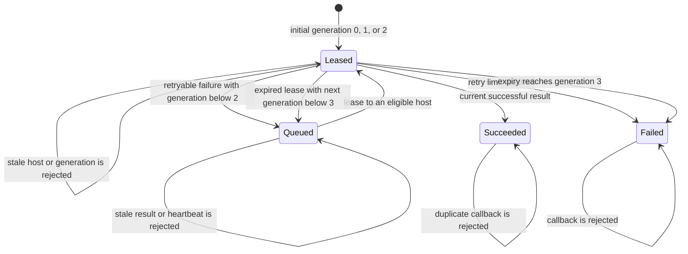

# Job lifecycle properties

The verifier executes production `leaseNextJob`, `extendJobLease`, `completeJob`,
`requeueExpiredJobs`, `returnToQueue`, `enqueueSynthesize`, and their SQL payload merger.
It reads persisted rows after each command. An independent state object computes
expected outcomes without calling production helpers.

## Properties and failure costs

| Property | Observable requirement | Failure cost |
| --- | --- | --- |
| Lease ownership | Heartbeats and results require the current leased status, host, and captured `attempts`. | A stale runner can complete work owned by a newer execution. |
| Completion at the write | Ownership still holds when the result update executes. | A result checked before a re-lease can overwrite the new lease. |
| Expiry at the write | Recovery still sees an expired lease and the captured generation. | Recovery can cancel a runner that renewed its lease. |
| Retry bound | Retry recovery stops after the configured three attempts. | A permanently broken job can run indefinitely. |
| Payload conservation | Every accepted source, document, and request survives enqueue and recovery. | Accepted user work can disappear. |
| Recovery transaction | Payload transfer and source retirement execute as one ordered transaction. | Reordered independent requests can retire the source before its payload is copied. |
| Clone exclusion | A space has at most one leased synthesize or consolidate job. | Concurrent runners can modify the same space clone. |
| Go wire generation | Both Go clients send the attempt captured for that job, including zero. | A callback can target a later same-host execution. |

## Bounds

The mutation manifest and coverage record carry the executable bounds:

- One initially leased translate job, two host names, and initial attempts 0, 1, and 2.
- Every length-three sequence over six commands. These produce 648 sequences and
  1,944 checked transitions.
- The commands are lease by either host, expiry recovery, original heartbeat,
  original success, and original retryable failure.
- Two spaces, three host request shapes, two clone job types, and every length-three
  request sequence. These produce 27 sequences and 81 lease requests.
- Targeted read/write interleavings for three completion statuses, same-host and
  different-host reassignment, and renewal at attempts 0 and 2.
- Three concurrent enqueue producers, duplicate recovery, and a 650-document union case.

The real SQLite database has the recorded generated schema dump and partial unique
queue index. The fixture inserts the recorded space membership seed and enables
foreign keys. The proxy executes Drizzle's generated SQL. Its batch implementation
uses `BEGIN IMMEDIATE`, ordered statements, and rollback on failure.

[D1's batch contract](https://developers.cloudflare.com/d1/worker-api/d1-database/#batch)
provides ordered SQL transactions. The local proxy represents that contract.
This verification assumes that contract and does not test deployed D1 behavior.

## Statechart

This chart describes the translate-job states exercised by the bounded oracle.
`attempts` is the captured retry generation. Leasing does not increment it.

Recovery increments the generation before requeue. An explicit retryable failure
increments it only when another attempt remains. Terminal callbacks retain the
current generation. Clone recovery can instead merge into a queued job of the same
type and space, then mark the source failed within the same batch.

## Counterexamples

A stale result must fail in this sequence:

1. Runner `vm` reads its leased job at attempt 0.
2. The lease expires, recovery requeues the job, and `vm` receives attempt 1.
3. The delayed result for attempt 0 tries to complete the job.
4. The result is rejected and the attempt-1 lease remains unchanged.

Without the generation predicate, the same-host result is accepted. Without the
write-time ownership predicate, the delayed completion can pass its earlier read.
The mutation reports retain the failed assertion and actual persisted outcome.

## Exclusions

This is bounded exhaustive execution plus targeted interleavings. It is not an
unbounded proof or an exhaustive scheduler exploration. It does not cover arbitrary
sequence lengths, every producer count, all payload shapes, deployed D1, transport
failures, runner process crashes, or external notification delivery.

Answer deadlines, translation output, source integration effects, and every review
flag path are outside the translate-job statechart. Focused ordinary tests exercise
some of those functions without expanding the stated exhaustive bounds.
The HTTP contract unit tests invoke real handlers with local SQLite. Separate E2E
checks must exercise the actual Worker HTTP boundary. No server or browser starts
as part of this helper.
