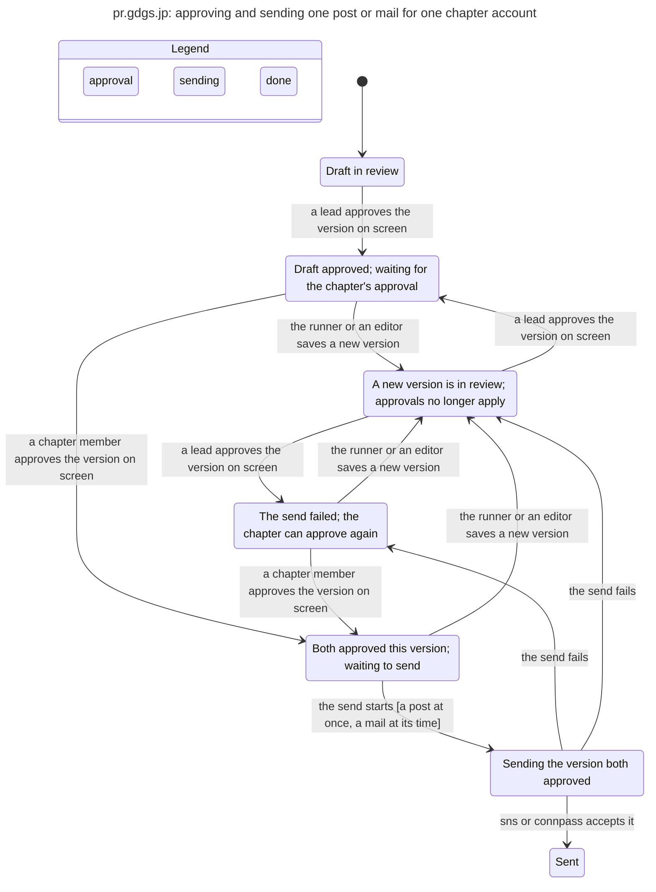

# Approval and send lifecycle

What a person sees for one post or mail and one chapter account, from the first draft to the
send. Each approval names the version on screen (`drafts.approved_version`,
`dispatch_targets.approved_version`). A send goes out only as the version that both the draft
approval and the chapter's approval name, and only while it is still the latest.

Pressing approve on a page that shows an older version, or without the right to approve, is
refused and changes nothing, inside or outside pr, so the chart draws no arrow for it. Approval
checks only read; the approval is written conditionally on the version, status and permission;
only then does pr act outside. A `{{shortlink}}` link belongs to the version it was created for
(`campaign_links.draft_id`, `draft_version`, slug `<campaign>-<kind>-<draft>v<version>`): the
draft approval creates it, a send that finds it missing creates it before sending, and a send
never uses another version's link. A connpass page or listing publishes the approved version. A new version saved while a send is under way does not change
what is sent. The chart leaves out レビュー OK, 差し戻す, 却下, more than one account,
delegating or skipping a target, and sns reporting a scheduled post as failed later.
`app/features/dispatch/dispatch.server.test.ts` replays the races the chart cannot show.

## Known gaps

- If url.gdgs.jp creates a version's link and the Worker stops before pr records it, the next
  attempt is refused as a taken slug instead of making a second link, and the send does not go
  out. The TinyURL RPC has no lookup by slug, so a person deletes the link in url.gdgs.jp and
  approves the target again.
- A Discord post whose link creation fails at its time is marked failed and is not retried.
- Links stored before migration 0012 stay for health checks and metrics; only those a sent
  target shows went out with a version are bound to it.

- `setDispatchMedia` (`app/features/dispatch/delivery.server.ts`, intent `media`) changes the
  image of an approved draft for anyone who can edit the campaign. The image is not part of a
  version, so the draft stays approved and the next target approval posts the new image.
- An X post target whose Worker stops after `approveTargetVersion` and before
  `claimApprovedTarget` stays `approved` for a version that is still current. Nothing claims
  it later and the page shows no approve button for it, so the post does not go out.
